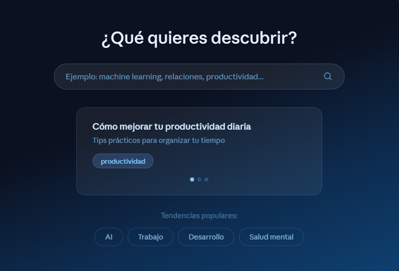
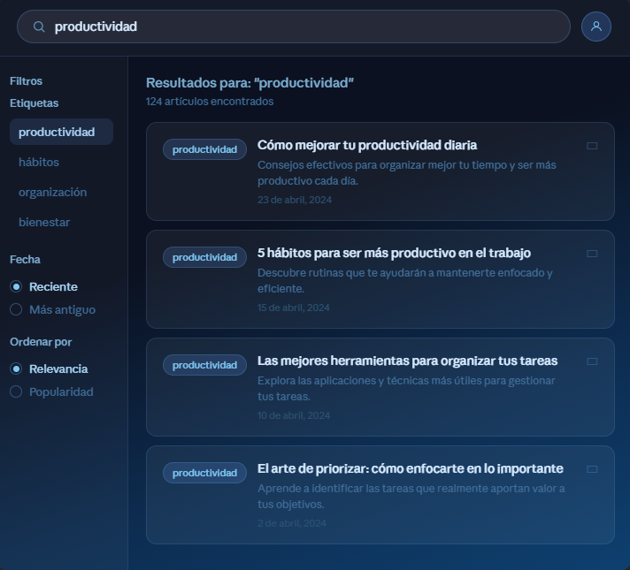
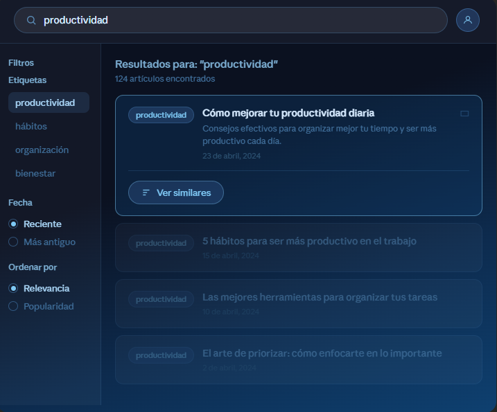
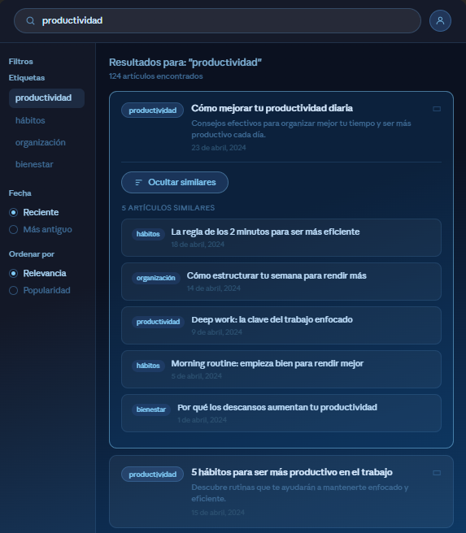

# 🚀 SmartSearch - Buscador Inteligente de Artículos

<p align="center">
  
  
  
  
</p>

---

## 🧠 Descripción

Sistema de búsqueda y recomendación de artículos de tecnología. El backend combina:

* **BM25** (`rank-bm25`, variante Okapi) para la relevancia léxica, con un índice para el título y otro para la categoría.
* **Embeddings** (`sentence-transformers`, modelo `all-MiniLM-L6-v2`) para la similitud semántica.

El frontend ofrece una experiencia visual moderna e interactiva para explorar el contenido.

👉 Guía de instalación paso a paso: [frontend/SETUP.md](frontend/SETUP.md)

---

## 🛠️ Tecnologías

| Área            | Tecnologías                                   |
| --------------- | --------------------------------------------- |
| 🎨 Frontend     | HTML, CSS y JavaScript (sin frameworks)       |
| 🔌 API          | FastAPI + Uvicorn                             |
| 🔍 Búsqueda     | BM25 (`rank-bm25`) + `sentence-transformers`  |
| 🗄️ Base de datos | PostgreSQL (`news_dw`, modelo estrella)       |
| 🧪 Pruebas      | `unittest` (Python)                           |

---

## 🎯 Funcionalidades UI

---

### 🎞️ Card Slider Automático

<p align="center">
  
</p>

✨ Características:

* 🔄 Slider automático de artículos
* ⬅️ Posibilidad de retroceder manualmente
* 🔁 Contenido cambia en cada refresh
* 🔥 **Tendencias populares**: las 12 categorías con más artículos de la base de datos; al hacer clic se busca ese tema

---

### 📰 Listado de Artículos

<p align="center">
  
</p>

📌 Reglas:

* 🔢 Máximo **10 artículos por página**
* 📄 Paginación en el footer
* 🚧 Ignorar barra lateral izquierda (temporal)

---

### 🧩 Interacción con Cards

<p align="center">
  
</p>

🖱️ Comportamiento:

* Al seleccionar una card:

  * 🌑 Las demás se oscurecen
  * 🔘 Aparece botón **"Ver similares"**
* 🚧 Ignorar barra lateral izquierda

---

### 🔍 Recomendaciones de Similitud

<p align="center">
  
</p>

🤖 Funcionalidad:

* Mostrar **5 artículos más similares**
* 🌕 Las demás cards se aclaran para mejor visual
* 🚧 Ignorar barra lateral izquierda

---

## ⚠️ Consideraciones Importantes

> 🚫 Ignorar por ahora:

* Descripciones de artículos en las cards
* Icono de cuenta (esquina superior derecha)
* Barra lateral izquierda

---

## 🔍 Cómo funciona la búsqueda

1. Al arrancar, la API carga los artículos de PostgreSQL (`title`, `url`, `category_name`).
2. `NLPRecomender.fit()` construye **una sola vez**:
   * un índice BM25 de los **títulos** (unigramas y bigramas, sin stop words en inglés),
   * un índice BM25 de las **categorías**,
   * los embeddings de `título + categoría`.
3. Para cada consulta se calcula:

   ```
   bm25  = 0.7 · BM25(título) + 0.3 · BM25(categoría)   # cada parte escalada a [0, 1]
   score = 0.5 · bm25 + 0.5 · similitud_coseno(embeddings)
   ```

4. Se devuelven los artículos ordenados por `score` (5 por defecto), descartando los de puntuación 0.

**"Ver similares"** usa el título y la categoría del artículo elegido como consulta, con la misma fórmula.

### Parámetros de BM25 (`NLPRecomender(...)`)

| Parámetro      | Defecto | Efecto                                                                                     |
| -------------- | ------- | ------------------------------------------------------------------------------------------ |
| `k1`           | 1.5     | Saturación de la frecuencia: cuanto más bajo, menos suma repetir un término                |
| `b`            | 0.75    | Normalización por longitud: 0 = no penaliza documentos largos, 1 = normalización completa  |
| `epsilon`      | 0.25    | Piso del idf para términos que aparecen en más de la mitad de los documentos               |
| `title_weight` | 0.7     | Peso del título en la parte léxica                                                         |
| `tag_weight`   | 0.3     | Peso de la categoría en la parte léxica                                                    |

---

## 📦 Inicio rápido

Requisitos: Python 3.12 y PostgreSQL con la base `news_dw` cargada (ver [SETUP.md](frontend/SETUP.md)).

```bash
# 1. Entorno virtual y dependencias
python -m venv myenv
source myenv/bin/activate          # Linux/Mac (fish: source myenv/bin/activate.fish)
# myenv\Scripts\activate           # Windows
pip install -r requeriments.txt

# 2. Backend (terminal 1)
uvicorn main:app --reload --port 8000

# 3. Frontend (terminal 2)
cd frontend
python -m http.server 5500
```

Abrir **http://localhost:5500/index.html**. Documentación interactiva de la API: **http://localhost:8000/docs**

---

## 📡 Endpoints de la API

| Método | Ruta                            | Descripción                                                        |
| ------ | ------------------------------- | ------------------------------------------------------------------ |
| GET    | `/health`                       | Estado de la API y número de artículos cargados                    |
| POST   | `/search`                       | Búsqueda. Body: `{"query": "quantum computing", "top_n": 10}`      |
| GET    | `/articles?limit=50&offset=0`   | Artículos paginados                                                |
| GET    | `/categories?limit=12`          | Categorías ordenadas por número de artículos                       |
| GET    | `/articles/{url}`               | Un artículo por su URL                                             |
| GET    | `/articles/{url}/related`       | Artículos similares a uno dado                                     |
| GET    | `/recommend/{url}`              | Igual que `/related`, con la clave `recommendations`               |

Cada artículo se devuelve como:

```json
{ "title": "...", "url": "https://...", "category_name": "Quantum Computing" }
```

La `{url}` del artículo va codificada en la ruta (`encodeURIComponent` en JavaScript).

---

## 🧪 Pruebas

```bash
python -m unittest discover -s tests -t . -v
```

Las pruebas usan un modelo de embeddings simulado, así que no necesitan PostgreSQL ni descargar el modelo.

---

## 🗂️ Estructura

```
Frontend_equipo/
├── main.py                       API FastAPI
├── requeriments.txt              Dependencias de Python
├── database/db_connection.py     Conexión a PostgreSQL
├── repository/article_repository.py  Consulta de artículos (title, url, category_name)
├── pipeline/train.py             Entrenamiento del modelo
├── vectorizer/NLPRecomender.py   Motor de búsqueda BM25 + embeddings
├── tests/                        Pruebas unitarias
├── POSTGRES_BD/                  Esquema, script de carga y CSV de la base news_dw
├── frontend/                     index.html, articles.html, app.js, styles.css, SETUP.md
└── mockup/                       Diseños de la interfaz
```

---

## 🤝 Comunicación

📢 Cualquier duda, error o mejora:

> Por favor comunicarlo directamente para iterar rápidamente sobre el desarrollo.

---

<p align="center">
  💡 Proyecto en construcción — iteración continua
</p>
